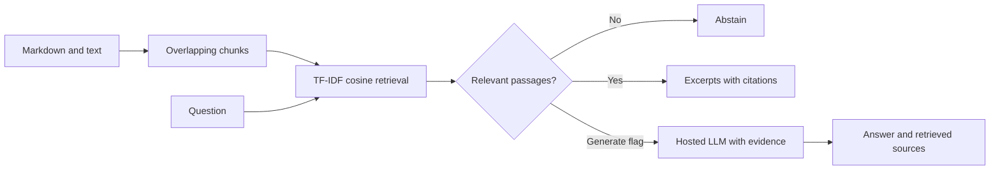

# EvidenceDesk

Document question answering with TF-IDF retrieval, source citations, and optional LLM generation.

**Status:** working command-line baseline. Local mode uses TF-IDF cosine retrieval and returns verbatim excerpts. Optional OpenAI mode implements retrieval augmented generation. This version does not include semantic embeddings, PDF parsing, a web UI, or production hosting.

## Quick start

Requires Python 3.11+. No third-party runtime dependencies for the baseline.

```bash
PYTHONPATH=src python -m evidencedesk.cli "What does ACID stand for?"
PYTHONPATH=src python -m evidencedesk.cli "How does TTL work?"
PYTHONPATH=src python -m evidencedesk.cli "Who won the football world cup?"
PYTHONPATH=src python -m unittest discover -s tests -v
PYTHONPATH=src python -m evidencedesk.evaluate
```

On Windows PowerShell, set `$env:PYTHONPATH="src"` first, then run the Python commands without the `PYTHONPATH=src` prefix. Optionally install with `python -m pip install -e .` to use the `evidencedesk` command.

Index Markdown and text files with `--docs PATH`. The `private-docs/` directory is gitignored. The `data/` directory contains three sample documents.

For generated answers, set `OPENAI_API_KEY` in your shell and optionally `OPENAI_MODEL`, then add `--generate`. Keep API keys in environment variables. This mode sends the question and retrieved passages to OpenAI and may incur API costs. `.env.example` documents settings; the application does not load `.env` files.

## Architecture



TF-IDF is an interpretable baseline, not a neural embedding model. The 0.12 similarity threshold is a heuristic; similarity is not calibrated confidence. Lexical retrieval misses paraphrases and can return passages that share words without answering the question. The index is rebuilt on each command and is intended for small corpora.

Generated citations are model-produced and are not automatically checked for factual support. Prompt instructions reduce some injection risk but do not provide a security boundary. This application has no tools that execute retrieved instructions. The current implementation is intended for local use and has no authentication or document access controls.

## Evaluation and verification

Tests cover retrieval, unknown questions, source attribution, chunk boundaries, invalid input, and a mocked generation request. The four-question synthetic benchmark is a smoke check, not a measure of broad RAG quality. Live provider generation requires credentials and separate evaluation.

Planned evaluation uses a labeled dataset with answerable and unanswerable questions, separate development and held-out splits, and reports Recall@5, MRR, abstention precision/recall, citation support, p50/p95 latency, and cost per answer. Dataset provenance and experiment configurations will accompany results.

## Roadmap

Planned work includes semantic retrieval, persistent indexing, PDF support, an HTTP API, hybrid search, and reranking. These features are not implemented in this release.

See `docs/ROADMAP.md` for milestones and `docs/ENGINEERING.md` for design decisions and evaluation requirements.

## License

MIT; see LICENSE.
